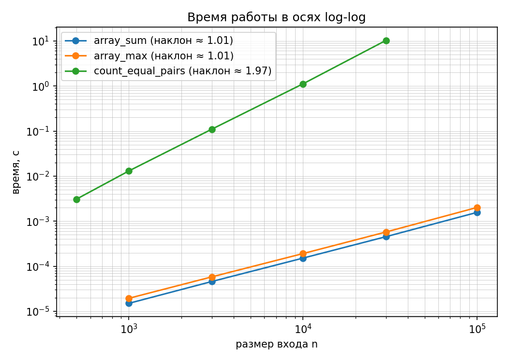
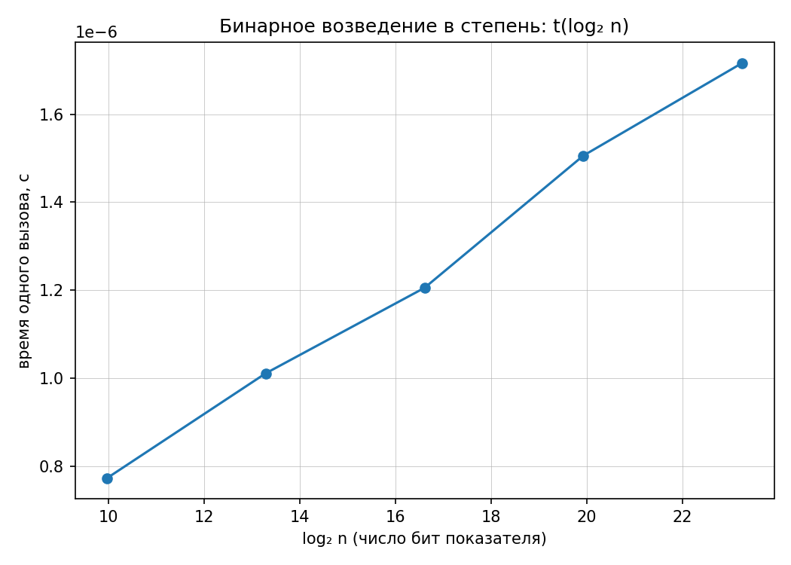

# Отчет по лабораторной работе № 1
## «Анализ временной сложности элементарных алгоритмов»

- **Дисциплина:** Структуры и алгоритмы обработки данных
- **Студент:** Дикарев Кирилл
- **Группа / Профиль:** ТОП-ИТ («Инженерия систем искусственного интеллекта»)
- **Вариант:** 9 (seed = 39)

---

## 1. Теоретический анализ алгоритмов (КИМ-01)

| Алгоритм | Временная сложность (худший случай) | Память | Аналитическое обоснование |
| :--- | :---: | :---: | :--- |
| `array_sum(a)` | $\Theta(n)$ | $O(1)$ | Один цикл по всем $n$ элементам, ровно $n$ операций сложения. Константный объем дополнительной памяти под переменную-аккумулятор. |
| `array_max(a)` | $\Theta(n)$ | $O(1)$ | Массив непуст ($n \ge 1$). Один цикл от $0$ до $n-1$, ровно $n$ обращений к элементам и $n-1$ операций сравнения. |
| `count_equal_pairs(a)` | $\Theta(n^2)$ | $O(1)$ | Вложенный цикл: внешний выполняется $n$ раз, внутренний — от $i+1$ до $n$. Суммарное число сравнений: $\sum_{i=0}^{n-1} (n - 1 - i) = \frac{n(n - 1)}{2} = \frac{1}{2}n^2 - \frac{1}{2}n = \Theta(n^2)$. |
| `binary_pow(x, n, mod)` | $\Theta(\log n)$ | $O(1)$ | На каждом шаге цикла `while n > 0` показатель степени делится на 2 через битовый сдвиг вправо (`n >>= 1`). Количество итераций равно числу бит в двоичной записи $n$, т.е. $\lfloor\log_2 n\rfloor + 1 = \Theta(\log n)$. Память $O(1)$, так как алгоритм реализован итеративно. |

---

## 2. Верификация решений и инварианты (docs/ai-verification.md)

В функции `self_check()` реализована четырехшаговая методика верификации:
1. **Граничные и репрезентативные тесты:**
   - Пустые массивы (`array_sum([]) == 0`, `count_equal_pairs([]) == 0`).
   - Массивы из одного элемента (`array_sum([7]) == 7`, `array_max([7]) == 7`).
   - Вырожденные случаи: массив одинаковых чисел (`count_equal_pairs([5, 5, 5]) == 3`).
   - Валидация исключений: `array_max([])` выбрасывает `ValueError`.
   - Граничные показатели степени: `binary_pow(x, 0) == 1`, $n=0$ с модулем дает $1 \pmod m$.
2. **Сверка с эталонными реализациями:**
   - 200 случайных тестов против доверенных эталонов Python: встроенных `sum()`, `max()` и трехпараметрического `pow(x, n, mod)`.
3. **Ключевые инварианты верификации:**
   - **`array_sum` (Аддитивность):** $\sum(A + B) = \sum A + \sum B$ и равенство $\sum [c] \times n = c \cdot n$.
   - **`array_max` (Принадлежность и мажорирование):** максимум гарантированно принадлежит массиву ($m \in A$) и мажорирует любой его элемент ($\forall x \in A: m \ge x$).
   - **`count_equal_pairs` (Комбинаторные границы):** ровно 0 пар на попарно различных элементах (`list(range(n))`) и ровно $C_n^2 = \frac{n(n-1)}{2}$ пар на массиве из $n$ одинаковых элементов.
   - **`binary_pow` (Алгебраические свойства степени):**
     - Мультипликативность: $x^{a+b} \equiv x^a \cdot x^b \pmod m$.
     - Возведение в степень степени: $x^{2a} \equiv (x^2)^a \pmod m$.

---

## 3. Эмпирические результаты замеров (Вариант 9, seed = 39)

Замеры проведены по методике воспроизводимости (`docs/reproducibility.md`): предварительный прогрев функции, $\ge 5$ повторов на точку, расчет медианного времени.

### Таблица 1. Время работы алгоритмов на массивах (Вариант 9)

| Размер входа $n$ | `array_sum`, с | `array_max`, с | `count_equal_pairs`, с |
| :---: | :---: | :---: | :---: |
| 500 | — | — | 0.003085 |
| 1 000 | 0.000015 | 0.000019 | 0.013041 |
| 3 000 | 0.000046 | 0.000058 | 0.110408 |
| 10 000 | 0.000152 | 0.000191 | 1.115880 |
| 30 000 | 0.000454 | 0.000576 | 10.296412 |
| 100 000 | 0.001568 | 0.002018 | — |

### Таблица 2. Время работы бинарного возведения в степень

Замеры выполнены пачками по $20\,000$ вызовов с усреднением времени одного вызова. Вычисления проводились по модулю $1\,000\,000\,007$.

| Показатель степени $n$ | $\log_2 n$ (число бит) | Время 1 вызова, с |
| :---: | :---: | :---: |
| $10^3$ | 10.0 | $0.773 \times 10^{-6}$ |
| $10^4$ | 13.3 | $1.011 \times 10^{-6}$ |
| $10^5$ | 16.6 | $1.205 \times 10^{-6}$ |
| $10^6$ | 19.9 | $1.506 \times 10^{-6}$ |
| $10^7$ | 23.3 | $1.716 \times 10^{-6}$ |

---

## 4. Анализ графиков и сопоставление с теорией

### А. Степенные алгоритмы (Log-Log анализ)

В двойных логарифмических осях $(\log_{10} n, \log_{10} t)$ степенная зависимость $t(n) \approx c \cdot n^k$ линеаризуется:
$$\log_{10} t = \log_{10} c + k \cdot \log_{10} n$$
где угловой коэффициент наклона прямой численно равен степени $k$.

- **Эмпирические наклоны прямых:**
  - `array_sum`: **1.01** (теория: 1.0, линейная сложность $O(n)$)
  - `array_max`: **1.01** (теория: 1.0, линейная сложность $O(n)$)
  - `count_equal_pairs`: **1.97** (теория: 2.0, квадратичная сложность $O(n^2)$)

> **Причины погрешностей и расхождений с теорией (TODO из main):**
> 1. **Накладные расходы интерпретатора CPython:** на малых размерах входа ($n \le 1\,000$) существенную часть времени занимают вызовы функций, динамическая типизация и диспетчеризация инструкций виртуальной машины.
> 2. **Иерархия кэшей процессора:** массивы малых размеров ($n \le 10\,000$) целиком помещаются в быстрый кэш L1/L2 процессора. При $n = 100\,000$ массив вытесняется в оперативную память (RAM), что приводит к росту задержек доступа из-за кэш-промахов (cache misses).

---

### Б. Бинарное возведение в степень (Обоснование осей)

> **Обоснование выбора линейных осей по $\log_2 n$ (TODO из plot_results):**
> 1. Если построить логарифмический алгоритм $t(n) \approx c \cdot \log_2 n$ в осях log-log, получится зависимость $\log t = \log c + \log(\log n)$. Производная этой функции $\frac{d(\log t)}{d(\log n)} = \frac{1}{\ln n} \to 0$ быстро стремится к нулю. В результате кривая выглядит пологой и в пределах погрешностей измерений визуально неотличима от константы $O(1)$.
> 2. В связи с этим по оси $X$ отложено число бит показателя степени $x = \log_2 n$. В координатах $(x, t)$ зависимость приобретает строго линейный вид:
>    $$t(x) = c \cdot x$$
>    Линейный вид полученного графика экспериментально доказывает, что время вычислений прямо пропорционально числу бит показателя степени, то есть алгоритм имеет логарифмическую сложность $O(\log n)$.
> 3. **Влияние модуля (`POW_MOD = 1_000_000_007`):** без ограничения вычислений по модулю Python автоматически включает длинную арифметику. При $n = 10^7$ число $3^{10^7}$ содержало бы миллионы десятичных знаков, и бенчмарк зафиксировал бы время операции умножения многоразрядных чисел ($O(M(L))$), а не число итераций бинарного возведения в степень.

---

## 5. Выводы
1. Все алгоритмы реализованы вручную и прошли верификацию на граничных тестах и инвариантах.
2. Эмпирические замеры на данных варианта 9 полностью подтвердили теоретические оценки асимптотической сложности $O(n)$, $O(n^2)$ и $O(\log n)$.
