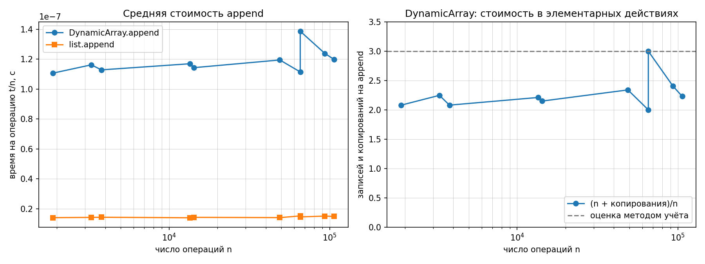
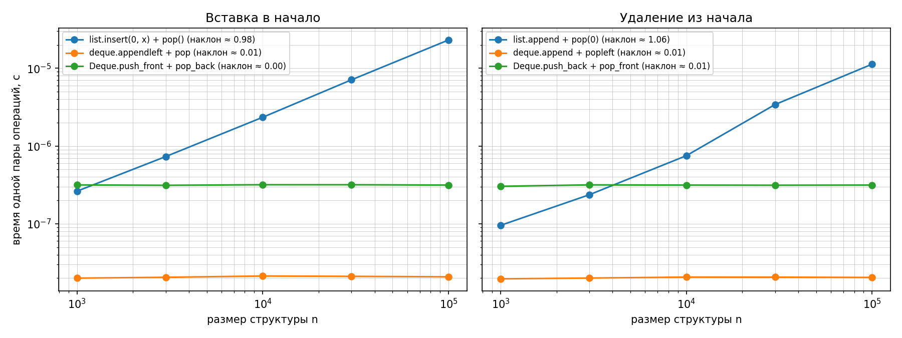

# Лабораторная работа № 2
# «Реализация рекурсивных функций и динамического массива, стека и дека»

- **Дисциплина:** Структуры и алгоритмы обработки данных
- **Студент:** Дикарев Кирилл
- **Группа / Профиль:** БВТ2503, ТОП-ИИ («Инженерия систем искусственного интеллекта»)
- **Вариант:** 9 (seed = 39)
- **Личный репозиторий:** [mtuci-labs-dsa](https://github.com/Kidukwe/mtuci-labs-dsa)
- **Основание:** [КИМ-02](https://github.com/mel0d1an/data-structures-and-algorithms/blob/main/M1-intro-and-basic-structures/kim-02-recursion-linear-structures.md) и [рубрика ЛР № 2](https://github.com/mel0d1an/data-structures-and-algorithms/blob/main/M1-intro-and-basic-structures/rubric-02-recursion-linear-structures.md)

---

## 1. Цель работы и состав файлов

Освоить базовое условие и рекурсивный переход, оценить стоимость повторного решения подзадач и выигрыш мемоизации. Реализовать собственный динамический массив, стек и дек; подтвердить корректность операций и обосновать амортизированную стоимость добавления методом учёта.

| Файл | Назначение |
| --- | --- |
| [lab02-recursion-structures-starter.py](lab02-recursion-structures-starter.py) | Алгоритмы, структуры, самопроверка, замеры и графики |
| [test_lab02.py](test_lab02.py) | Дополнительные автоматические проверки |
| [reports/results.json](reports/results.json) | Числа без округления, условия эксперимента, SHA-256 входных файлов |
| [reports/run.log](reports/run.log) | Вывод полного запуска |
| [reports/lab02_append.png](reports/lab02_append.png) | Средняя стоимость добавления и счётчик копирований |
| [reports/lab02_front.png](reports/lab02_front.png) | Вставка и удаление у начала структур |
| [../scripts/generate_data.py](../scripts/generate_data.py) | Официальный генератор данных курса, без изменений |

Основной файл основан на [заготовке кафедры](https://github.com/mel0d1an/data-structures-and-algorithms/blob/main/M1-intro-and-basic-structures/attachments/lab02-recursion-structures-starter.py). Сохранены интерфейсы и все разделы проверки; добавлены реализации, собственные инварианты, проверка паспорта, режим `--check-only` и сохранение JSON. Автор исходных материалов — ФГБОУ ВО МТУСИ, кафедра «Программная инженерия», 2026; лицензия [CC BY 4.0](https://github.com/mel0d1an/data-structures-and-algorithms/blob/main/LICENSE.md).

## 2. Воспроизводимый запуск

Команды выполняются **из корня личного репозитория**, Python 3.10+:

```bash
python3 -m venv .venv
source .venv/bin/activate
python -m pip install -r requirements.txt
python scripts/generate_data.py --variant 9 --only ops
python lab02/lab02-recursion-structures-starter.py --variant 9
```

Если `.venv` уже существует, достаточно активировать его. По умолчанию результаты сохраняются в `lab02/reports`, независимо от текущей рабочей папки. Для отдельного прогона без перезаписи приложенных результатов:

```bash
python lab02/lab02-recursion-structures-starter.py --variant 9 --out /tmp/lab02-run
```

Проверки без замеров, включая режим оптимизации:

```bash
python lab02/lab02-recursion-structures-starter.py --variant 9 --check-only
python -O lab02/lab02-recursion-structures-starter.py --variant 9 --check-only
python -m pytest -q lab02/test_lab02.py
python -O -m pytest -q lab02/test_lab02.py
```

Оформление проверено Black и Ruff. Для повторения проверки:

```bash
python -m pip install black ruff
python -m black --check --line-length 79 lab02/*.py
python -m ruff check --select E,F,I --line-length 79 lab02
```

Генератор создаёт `ops_stack.txt`, `ops_deque.txt`, `ops_append_sizes.txt` и `manifest.json` в `data/generated`. Этот каталог исключён из Git. Паспорт должен содержать вариант 9 и seed 39; при отсутствии или несовпадении паспорта работа прекращается. Наборы воспроизводятся генератором; контрольные суммы приложены в JSON.

## 3. Рекурсивные алгоритмы и сложность

### 3.1. Факториал

Базовый случай: $0! = 1$. Переход: $n! = n(n-1)!$. Отрицательный аргумент вызывает `ValueError`. Для `factorial(4)` одновременно хранятся вызовы с аргументами 4, 3, 2, 1 и 0. Каждый незавершённый вызов помнит свой аргумент и ждёт результата вложенного вызова; только самый глубокий сейчас выполняет инструкции.

Число вызовов — $n+1$, число умножений — $n$. Рекуррентность $T(n)=T(n-1)+\Theta(1)$ даёт $\Theta(n)$ арифметических операций. Дополнительная память — $\Theta(n)$ кадров стека, а не $O(1)$.

### 3.2. Наивный Фибоначчи

Базы: $F(0)=0$, $F(1)=1$. Переход: $F(n)=F(n-1)+F(n-2)$. Два дочерних вызова многократно вычисляют одинаковые значения.

Счётчик увеличивается при **каждом входе** в функцию, включая базовые случаи. Для $C(0)=C(1)=1$ и $C(n)=1+C(n-1)+C(n-2)$:

$$C(n)=2F(n+1)-1.$$

Время — $\Theta(\varphi^n)$, где $\varphi=(1+\sqrt5)/2$; $O(2^n)$ является менее точной верхней оценкой. Глубина стека — $\Theta(n)$: число узлов дерева вызовов экспоненциально, но одновременно хранится только текущая ветвь.

### 3.3. Фибоначчи с мемоизацией

Словарь связывает индекс с уже вычисленным числом. Если значение известно, функция сразу возвращает его. Все рекурсивные вызовы получают **один общий словарь**. Аргумент по умолчанию — `None`: новый внешний вызов создаёт новый словарь, а не использует изменяемый объект между запусками.

Счётчик учитывает и попадания в кеш. Для вычисления с пустым кешем:

$$C_{memo}(n)=\begin{cases}1,&n=0\text{ или }n=1,\\2n-1,&n\ge2.\end{cases}$$

При $n\ge2$ подзадачи с индексами 2…n разворачиваются ровно по одному разу и каждая порождает два вызова: $1+2(n-1)$. Значения базовых случаев также сохраняются. При ожидаемой постоянной стоимости словаря время — $\Theta(n)$, память — $\Theta(n)$ ячеек кеша и кадров стека. Если передан кеш с готовым ответом, вызов стоит ожидаемые $\Theta(1)$; это другой режим входа.

**Таблица числа вызовов — фактический запуск:**

| n | F(n) | Наивные вызовы | Вызовы с мемоизацией |
| --- | --- | --- | --- |
| 5 | 5 | 15 | 9 |
| 10 | 55 | 177 | 19 |
| 15 | 610 | 1973 | 29 |
| 20 | 6765 | 21891 | 39 |
| 25 | 75025 | 242785 | 49 |
| 30 | 832040 | 2692537 | 59 |

### 3.4. Ханойские башни

Сначала n−1 дисков переносятся на вспомогательный стержень, затем один диск — на целевой, затем n−1 дисков — со вспомогательного на целевой. На каждой стадии меняются роли стержней. Для нуля дисков ходов нет.

Количество перемещений удовлетворяет $H(0)=0$, $H(n)=2H(n-1)+1$, поэтому $H(n)=2^n-1$. Алгоритм выполняет рекурсивные переходы и без журнала ходов, не подменяя их готовой формулой. С переданным `moves` пары «откуда, куда» дописываются в этот же список.

Время — $\Theta(2^n)$, память стека — $\Theta(n)$. При сохранении всех ходов дополнительно требуется $\Theta(2^n)$ памяти для результата. Проверка проигрывает ходы на трёх модельных стержнях: запрещены ходы с пустого стержня и укладка большего диска на меньший; в конце все диски должны оказаться на целевом стержне.

### 3.5. Границы модели сложности

| Алгоритм | Лучшее / среднее / худшее время для фиксированного n | Дополнительная память |
| --- | --- | --- |
| Рекурсивный факториал | $\Theta(n)$ операций во всех случаях | $\Theta(n)$ кадров |
| Наивный Фибоначчи | $\Theta(\varphi^n)$ во всех случаях | $\Theta(n)$ кадров |
| Фибоначчи с пустым кешем | Ожидаемые $\Theta(n)$ при обычной работе словаря | $\Theta(n)$ ячеек и кадров |
| Ханойские башни | $\Theta(2^n)$ во всех случаях | $\Theta(n)$ стек; $\Theta(2^n)$ журнал |

Для функций с единственным числовым входом при фиксированном n нет разных порядков элементов: ход вычисления определён. Для кеша отдельно оговорено начальное состояние, для `dict` — ожидаемая стоимость поиска; патологические коллизии не входят в эту модель.

**Длинная арифметика Python:** таблица считает арифметические операции, ячейки и кадры. Число $n!$ занимает $\Theta(n\log n)$ бит, а $F(n)$ — $\Theta(n)$ бит, поэтому умножение и сложение больших чисел нельзя считать безусловно постоянными по времени. Полный кеш $F(0)…F(n)$ содержит $\Theta(n^2)$ бит числовых данных. Эти оценки не заменяются на $O(n)$ байт. Счётчики вызовов позволяют исследовать именно структуру рекурсии. Большие n также ограничены максимальной глубиной рекурсии Python; лимит в работе не увеличивается.

## 4. Собственные структуры данных

### 4.1. DynamicArray

Состояние — буфер, логический размер `size`, выделенная ёмкость `capacity` и суммарное число перенесённых ссылок `copies`. Начальная ёмкость — 4. Буфер создан как `[None] * capacity`; для его изменения запрещены `list.append`, `list.insert` и `list.pop`.

При наличии места `append` записывает значение в `buffer[size]`, затем увеличивает размер. Если буфер заполнен, выделяется буфер вдвое больше, активные элементы копируются по индексам, счётчик увеличивается на число перенесённых элементов. Порядок и идентичность объектов сохраняются: копируются ссылки, не сами объекты.

`get` и `set` допускают только $0\le index<size$; отрицательные индексы и доступ в свободную часть вызывают `IndexError`. `set` не увеличивает размер. `pop` возвращает последний элемент и очищает освободившуюся ячейку, чтобы не удерживать объект. Пустой массив вызывает `IndexError`.

**Сжатие не реализовано**, что разрешено КИМ-02. Память — $\Theta(capacity)$, включая свободные ячейки; после удаления элементов ёмкость остаётся прежней. Для серии добавлений с нуля `capacity < 2n` при $n\ge4$, но после опустошения память нельзя оценивать через текущий размер. Она ограничена максимумом достигнутого размера. При росте некоторое время существуют оба буфера; пиковая память также $\Theta(capacity)$.

Инварианты:

- $0\le size\le capacity$ и длина буфера равна ёмкости;
- активные элементы занимают префикс `[0, size)` в правильном порядке;
- свободные ячейки содержат `None`, при этом `None` допустим и как активное значение;
- рост происходит только при заполнении и удваивает ёмкость;
- `copies` учитывает каждую переносимую ссылку, но не новую запись и не инициализацию пустых ячеек.

### 4.2. Stack

Стек использует только `DynamicArray.append`, `pop`, `get` и `len`. `push` добавляет в конец, `pop` снимает последний элемент, `peek` читает последний элемент без удаления. Порядок — LIFO: последний добавленный извлекается первым. Обращения к внутреннему буферу массива из стека отсутствуют.

### 4.3. Deque

Схема непустого дека:

```text
head → [value | prev | next] ⇄ [value | prev | next] ← tail
```

Хранятся ссылки на первый и последний узлы и количество узлов. Для пустого дека `head` и `tail` равны `None`; для одного элемента указывают на один узел. У первого узла `prev=None`, у последнего `next=None`. Соседние ссылки согласованы в обоих направлениях.

Добавление создаёт один узел и меняет несколько ссылок. Удаление переставляет крайний указатель и разрывает связь с удалённым узлом. При удалении единственного элемента обнуляются оба крайних указателя. Обход списка для операций концов не нужен.

| Операция | Лучший случай | Худший случай | Стоимость по серии |
| --- | --- | --- | --- |
| `DynamicArray.append` | $\Theta(1)$ | $\Theta(n)$ при росте | Амортизированные $\Theta(1)$ |
| `DynamicArray.pop/get/set/len` | $\Theta(1)$ | $\Theta(1)$ | $\Theta(1)$ |
| `Stack.push` | $\Theta(1)$ | $\Theta(n)$ при росте массива | Амортизированные $\Theta(1)$ |
| `Stack.pop/peek/len` | $\Theta(1)$ | $\Theta(1)$ | $\Theta(1)$ |
| Четыре операции концов `Deque` | $\Theta(1)$ | $\Theta(1)$ | $\Theta(1)$ |

Средний случай отдельного `append` требует распределения вероятностей состояний; оно не задано. Амортизированная оценка относится к последовательности операций и не означает вероятностный средний случай. Оценки не учитывают стоимость пользовательских деструкторов объектов и задержки системного выделения памяти. Дек хранит $\Theta(n)$ узлов; у стека память определяется ёмкостью массива.

### 4.4. Выбор структур и альтернативы

Массив даёт постоянный доступ по индексу и небольшие накладные расходы на ссылки, но добавление при росте требует копирования. Связный список позволяет менять концы без сдвига остальных значений, но каждый узел хранит две дополнительные ссылки; доступ к произвольному индексу требует обхода.

Стек на связном списке также возможен, однако задание требует собственный массив. Дек на кольцевом буфере мог бы улучшить локальность данных, но рост требовал бы копирования и амортизированного анализа; в этой ЛР задан двусвязный список. Стандартные `list` и `collections.deque` используются как эталоны и участники сравнения. Стандартный дек CPython имеет блочную организацию, поэтому не следует считать его точной копией нашей структуры.

## 5. Амортизированный анализ append методом учёта

### 5.1. Банковский метод

В учебной модели одна запись нового значения и одно копирование ссылки стоят по одной единице. Назначим каждому `append` плату **3 единицы**: одна оплачивает новую запись, две пополняют общий запас кредита.

При расширении ёмкости с C до 2C копируются C элементов. В предыдущем промежутке между расширениями было C/2 добавлений, каждое оставило две единицы: накоплено C единиц, которых хватает на перенос. Первый рост с 4 до 8 оплачивается кредитом первых четырёх добавлений. Запас никогда не становится отрицательным.

Для N последовательных добавлений сумма копирований:

$$copies=4+8+16+\dots+\frac{capacity}{2}=capacity-4.$$

Для `capacity=4` сумма пуста и равна нулю. После первого расширения $capacity<2N$, поэтому $copies<2N$, а значит:

$$\frac{N+copies}{N}<3.$$

Общая стоимость — $O(N)$, средняя стоимость добавления по серии — $O(1)$. Каждое добавление требует хотя бы одной записи, поэтому амортизированная оценка точнее выражается как $\Theta(1)$.

Граница 3 относится **только к новым записям и переносу ссылок**. Реальный Python также инициализирует `[None] * new_capacity`. Если считать и эти записи, каждый рост C→2C создаёт 2C пустых ячеек: вместе с переносом получается 3C действий. В том же методе учёта можно брать постоянную плату 7, оставляя 6 единиц за добавление; их хватает на эти 3C действий. Общая асимптотика остаётся $\Theta(1)$, а наблюдаемое время не обязано совпадать с числом `N + copies`.

### 5.2. Соседние размеры варианта

Для N=65 536 ёмкость равна 65 536 и `copies=65 532`. Следующее добавление вызывает расширение: для N=65 537 ёмкость равна 131 072 и `copies=131 068`.

Нормированная стоимость меняется с 1.999939 до 2.999908. Она близка к 3, но строго меньше неё. В текстовом выводе с тремя знаками это округляется до `3.000`. Это скачок в константе из-за одного дорогого расширения, а не нарушение амортизированной оценки.

## 6. Верификация и результаты проверок

Проверки выполнены по [методике кафедры](https://github.com/mel0d1an/data-structures-and-algorithms/blob/main/docs/ai-verification.md): инварианты → репрезентативные тесты → эталоны → оценка сложности и производительности. Реализация подготовлена с помощью ИИ; автоматические результаты ниже не являются проверкой понимания на защите.

| Проверка | Что проверялось | Результат |
| --- | --- | --- |
| Рекурсия, раздел шаблона | Факториал 0…20, обе версии Фибоначчи, счётчики, допустимость ходов Ханоя и произвольные имена стержней | OK |
| Массив, раздел шаблона | Пустой вход, доступ за границами, рост 4→8→16→32→64→128, точные `copies`, опустошение и повторное наполнение | OK |
| Стек, раздел шаблона | LIFO, неизменность при `peek`, ошибки пустого стека, 3 000 случайных операций | OK |
| Дек, раздел шаблона | Все сочетания концов при переходах 0↔1, 5 000 случайных операций | OK |
| Собственные инварианты | Формулы вызовов, отрицательные входы, `None` и дубликаты, очистка буфера, прямые/обратные связи на 2 000 операциях | OK |
| Данные варианта 9 | 100 000 операций стека против `list`, 100 000 операций дека против `collections.deque`; результат и размер после каждого шага | OK |
| Исходный `self_check` кафедры | Все пять неизменённых разделов исходного файла вызваны с нашими реализациями | OK |
| Дополнительные тесты | Холодный/тёплый кеш, независимость внешних вызовов, проверка каждого префикса 10 000 добавлений, освобождение объекта через `weakref`, смешанные операции, обнаружение сломанной связи, паспорт данных, запуск CLI | 30 passed |
| Режим оптимизации | `--check-only` и те же 30 тестов с `python -O` | OK / 30 passed |
| Оформление | Black с длиной строки 79; Ruff `E,F,I` | OK |

Все проверки написаны через явные исключения (`expect`, `pytest.raises`), а не через отключаемые `assert`. При запуске pytest с `-O` сам pytest предупреждает об отключении обычных `assert`; наши проверки продолжают работать. Структурные обходы дека и массива выполняются в проверках, а не внутри измеряемых методов.

**Технический вывод о применимости:** принять реализацию для рассмотренных контрактов — тесты и инварианты выполняются, измерения согласуются с аналитическими оценками. Объяснение каждой функции и доказательств — отдельная часть подготовки к защите.

## 7. Условия эксперимента

- **Замер:** 08.10.2026 22:18:54, московское время.
- **Процессор:** Apple M5; архитектура arm64; оперативная память 24 ГиБ.
- **Система:** macOS 26.6.2; **Python:** 3.10.7; NumPy 2.2.6; Matplotlib 3.10.9; pytest 8.4.2.
- **Оформление:** Black 26.10.0; Ruff 0.16.10.
- **Питание:** от сети, подтверждено `pmset -g batt` перед замерами. Состояние всех фоновых процессов не фиксировалось.
- **Таймер:** `time.perf_counter`; один прогрев и пять измеряемых повторов каждой точки; итог — медиана.
- Входные файлы читаются до начала замеров; сравниваемые структуры получают одинаковые операции. Счётчики Фибоначчи измеряются отдельно, это не время вычисления.
- Внутри измеряемых повторов циклический сборщик мусора отключается; исходное состояние восстанавливается. Подсчёт ссылок продолжает работать. Сборка мусора перед серией и структурные проверки не входят в измерения.
- Для `append` измеряется полная серия из N добавлений в новый массив/список, затем время делится на N. Время включает создание пустой структуры и завершение вызова серии.
- Для операций у начала измеряется пачка **1 000 пар**. Пара «вставить в начало + удалить с конца» или «добавить в конец + удалить из начала» сохраняет размер структуры. Создание наполненной структуры вынесено за таймер. После деления на 1 000 получается время **пары**, а не изолированной операции.
- Время операций варианта включает цикл воспроизведения и обработку ожидаемых `IndexError` на пустых структурах, но не чтение файлов и не сверку с эталоном.

Точные числа и контрольные суммы входов сохранены в [results.json](reports/results.json). Данные детерминированы; времена при повторном запуске могут измениться.

Повторная генерация во временный каталог дала побайтное совпадение всех трёх входных файлов и паспорта с данными выполненного эксперимента.

## 8. Результаты эксперимента

### 8.1. Средняя стоимость добавления

Время в микросекундах на один `append` ($1\ \text{мкс}=10^{-6}\ \text{с}$):

| n | Ёмкость | copies | (n + copies) / n | DynamicArray, мкс/append | list, мкс/append |
| --- | --- | --- | --- | --- | --- |
| 1893 | 2048 | 2044 | 2.079768 | 0.110671 | 0.014043 |
| 3280 | 4096 | 4092 | 2.247561 | 0.116209 | 0.014253 |
| 3787 | 4096 | 4092 | 2.080539 | 0.112842 | 0.014347 |
| 13522 | 16384 | 16380 | 2.211359 | 0.116945 | 0.013977 |
| 14251 | 16384 | 16380 | 2.149393 | 0.114311 | 0.014277 |
| 48905 | 65536 | 65532 | 2.339986 | 0.119458 | 0.014082 |
| 65536 | 65536 | 65532 | 1.999939 | 0.111473 | 0.015223 |
| 65537 | 131072 | 131068 | 2.999908 | 0.138668 | 0.014582 |
| 93279 | 131072 | 131068 | 2.405118 | 0.123816 | 0.015098 |
| 106403 | 131072 | 131068 | 2.231807 | 0.119843 | 0.014873 |



На всех размерах нормированное число записей и копирований меньше 3. Время собственного добавления остаётся в узком диапазоне; скачок после 65 536 соответствует расширению буфера. `list.append` быстрее по константе, поскольку его реализация выполняется в C и использует другую стратегию роста. График подтверждает наблюдаемый характер роста; доказательство для произвольной длины серии дано методом учёта.

### 8.2. Вставка и удаление у начала

Значения — **микросекунды на пару операций**, колонки соответствуют текущему размеру структуры.

**Вставка в начало с удалением из конца:**

| Пара операций | 1000 | 3000 | 10000 | 30000 | 100000 | Наклон |
| --- | --- | --- | --- | --- | --- | --- |
| `list.insert(0, x) + pop()` | 0.262458 | 0.731208 | 2.345167 | 7.098208 | 23.119625 | 0.975 |
| `deque.appendleft + pop` | 0.020000 | 0.020500 | 0.021291 | 0.021083 | 0.020792 | 0.009 |
| `Deque.push_front + pop_back` | 0.316125 | 0.312583 | 0.317833 | 0.317791 | 0.314625 | 0.001 |

**Удаление из начала с добавлением в конец:**

| Пара операций | 1000 | 3000 | 10000 | 30000 | 100000 | Наклон |
| --- | --- | --- | --- | --- | --- | --- |
| `list.append + pop(0)` | 0.095500 | 0.236041 | 0.751459 | 3.415583 | 11.297625 | 1.061 |
| `deque.append + popleft` | 0.019583 | 0.020042 | 0.020625 | 0.020583 | 0.020417 | 0.010 |
| `Deque.push_back + pop_front` | 0.303458 | 0.316500 | 0.314541 | 0.313250 | 0.314792 | 0.005 |



У `list` добавление/удаление у начала сдвигает ссылки на остальные элементы. Число сдвигов пропорционально n, поэтому цена пары растёт почти линейно. У собственного дека меняется фиксированное число ссылок, и цена пары почти не зависит от n. Встроенный дек также поддерживает эффективные операции концов и показывает меньший постоянный множитель.

В осях log-log для $t(n)\approx c n^k$ имеем $\log t=\log c+k\log n$: наклон оценивает k. Наклоны для `list` близки к 1, для деков — к 0. Небольшие отклонения могут быть связаны с постоянными расходами, распределением памяти, кешами и системным шумом; вклад этих факторов отдельно не измерялся. График сам по себе не доказывает асимптотику и не гарантирует такие же времена на другой машине.

### 8.3. Операции своего варианта

| Последовательность | Операций | Своя структура, мкс/оп. | Эталон, мкс/оп. | Отношение времени |
| --- | --- | --- | --- | --- |
| `ops_stack.txt` | 100000 | 0.156915 | 0.029523 | 5.32 |
| `ops_deque.txt` | 100000 | 0.182593 | 0.031875 | 5.73 |

Собственный стек и дек медленнее стандартных по постоянному множителю. В своих реализациях выполняются Python-вызовы методов, проверки и обращения к атрибутам; в стандартных структурах большая часть этой работы реализована в C. Эта разница не противоречит одинаковой асимптотике операций.

## 9. Выводы

1. Рекурсивный факториал имеет линейную цепочку вызовов и линейную память стека. Наивный Фибоначчи создаёт дерево вызовов с повторными подзадачами; мемоизация сокращает их число до линейного.
2. Ханойские башни формируют допустимые перемещения; число ходов совпадает с $2^n-1$. Сохранение журнала требует памяти пропорционально числу ходов.
3. Ручной рост ёмкости массива ×2 обеспечивает амортизированное $\Theta(1)$ добавление. Отдельное добавление при росте остаётся линейным.
4. Стек сохраняет LIFO, дек поддерживает оба конца без обхода списка. Переходы между пустой структурой и одним элементом проверены отдельно.
5. Все разделы самопроверки и дополнительные тесты проходят, включая режим `python -O`. На данных варианта 9 результаты операций совпадают с эталонами.
6. Замеры согласуются с аналитическими оценками. Стандартные структуры быстрее по константе; собственные реализации раскрывают устройство операций и стоимость управления памятью.

## 10. Порядок разбора перед защитой

1. **Начать с `factorial`:** выписать стек для n=4. Должно получиться пять одновременно хранящихся вызовов, а не два. Объяснить четыре умножения и различие числа вызовов, глубины и числа операций.
2. **Сравнить Фибоначчи:** нарисовать дерево для n=5, найти повторные подзадачи, проверить таблицу счётчиков. Затем проследить передачу одного словаря через рекурсию.
3. **Проиграть Ханой для трёх дисков:** подписать роли `src`, `dst`, `aux` и обосновать рекуррентность количества ходов.
4. **Проследить пятое добавление в массив:** записать `size`, `capacity`, `copies` до и после. Проверить, какие действия учитывает счётчик и какие он не учитывает.
5. **Разобрать стек и дек:** показать LIFO; нарисовать ссылки до и после удаления единственного узла и удаления края у двух узлов.
6. **Объяснить метод учёта:** почему плата 3 достаточна в модели записей/копирований; почему один дорогой шаг не нарушает постоянную среднюю стоимость по серии.
7. **Прочитать графики:** назвать единицы измерения, отличить время пары от времени одной операции, объяснить наклоны и постоянные множители.

**Вопрос о мастер-теореме из КИМ:** для $T(n)=aT(n/b)+f(n)$, $a\ge1$, $b>1$, сравнивают $f(n)$ с $n^{\log_b a}$:

- Если $f(n)=O(n^{\log_b a-\varepsilon})$ для некоторого $\varepsilon>0$, то $T(n)=\Theta(n^{\log_b a})$. Пример: $4T(n/2)+n$ даёт $\Theta(n^2)$.
- Если $f(n)=\Theta(n^{\log_b a})$, то $T(n)=\Theta(n^{\log_b a}\log n)$. Пример: $2T(n/2)+n$ даёт $\Theta(n\log n)$.
- Если $f(n)=\Omega(n^{\log_b a+\varepsilon})$ и выполняется регулярность $af(n/b)\le cf(n)$ для некоторого $c<1$ при достаточно большом n, то $T(n)=\Theta(f(n))$. Пример: $2T(n/2)+n^2$ даёт $\Theta(n^2)$.

К рекуррентностям факториала, Фибоначчи и Ханоя из этой реализации стандартная мастер-теорема не применяется напрямую: аргумент уменьшается на 1, а не делится на постоянное b. Здесь используются цепочки/деревья вызовов и собственные рекуррентные соотношения.
