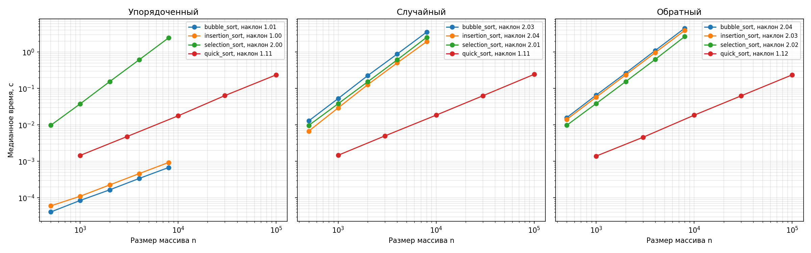

# Лабораторная работа № 3
# «Простые сортировки и QuickSort с рандомизацией опорного элемента»

- **Дисциплина:** Структуры и алгоритмы обработки данных
- **Студент:** Дикарев Кирилл
- **Группа / Профиль:** БВТ2503, ТОП-ИИ («Инженерия систем искусственного интеллекта»)
- **Вариант:** 9; базовый seed = 39
- **Личный репозиторий:** [mtuci-labs-dsa](https://github.com/Kidukwe/mtuci-labs-dsa)

## 1. Задание и состав работы

По [КИМ-03](https://github.com/mel0d1an/data-structures-and-algorithms/blob/main/M2-sorting/kim-03-simple-sorts-quicksort.md) требуется реализовать пузырёк, вставки и выбор со счётчиками сравнений и обменов/перемещений; QuickSort со случайным опорным элементом; продемонстрировать стабильность; проверить инварианты и совпадение с `sorted()` на сотнях входов; провести воспроизводимые замеры на трёх классах массивов и построить log-log графики.

| Файл | Содержание |
| --- | --- |
| [lab03-simple-sorts-quicksort-starter.py](lab03-simple-sorts-quicksort-starter.py) | Четыре сортировки, генерация входов, проверки, демонстрация стабильности, замеры и график |
| [test_lab03.py](test_lab03.py) | 45 дополнительных тестовых случаев |
| [reports/results.json](reports/results.json) | Все времена повторов, медианы, счётчики, наклоны, данные о питании и контрольные суммы |
| [reports/run.log](reports/run.log) | Вывод полного запуска |
| [reports/lab03_sorting.png](reports/lab03_sorting.png) | Графики для трёх классов входов |

Интерфейсы, генерация классов входов и планы размеров взяты из [заготовки курса](https://github.com/mel0d1an/data-structures-and-algorithms/blob/main/M2-sorting/attachments/lab03-simple-sorts-quicksort-starter.py); алгоритмы и дополнительные проверки реализованы в этой работе. Исходные материалы: ФГБОУ ВО МТУСИ, кафедра «Программная инженерия», 2026, [CC BY 4.0](https://github.com/mel0d1an/data-structures-and-algorithms/blob/main/LICENSE.md). Реализация подготовлена с помощью ИИ и проверена автоматически; понимание решения проверяется отдельно при разборе и защите.

Код по запросу оформлен без комментариев и docstring. Пояснения вынесены в README.

## 2. Запуск

Из корня репозитория, Python 3.10+:

```bash
source .venv/bin/activate
python -m pip install -r requirements.txt
python lab03/lab03-simple-sorts-quicksort-starter.py --variant 9
```

Данные генерируются внутри сценария, как в заготовке ЛР № 3. Отдельная генерация файлов массивов и паспорт `manifest.json` для этой работы не требуются.

Проверки без длительных замеров:

```bash
python lab03/lab03-simple-sorts-quicksort-starter.py --variant 9 --check-only
python -m pytest -q lab03/test_lab03.py
python -O -m pytest -q lab03/test_lab03.py
```

Для сохранения нового прогона отдельно:

```bash
python lab03/lab03-simple-sorts-quicksort-starter.py --variant 9 --out /tmp/lab03-run
```

Проверка оформления (Black и Ruff устанавливаются отдельно через `pip install black ruff`):

```bash
python -m black --check --line-length 79 lab03/*.py
python -m ruff check --select E,F,I --line-length 79 lab03
```

## 3. Контракты и счётчики

Все сортировки возвращают **новый список** и сохраняют исходный. Пузырёк, вставки и выбор возвращают `(список, сравнения, обмены_или_перемещения)`. QuickSort возвращает список, как предусмотрено интерфейсом заготовки.

Аргумент `key` позволяет сравнивать только ключ записи. По умолчанию используется `identity`: ключом является само значение. Для пар передаётся `key=lambda pair: pair[0]`, поэтому метка не влияет на сравнение.

Счётчики имеют следующие определения:

- **Сравнения:** только сравнения ключей элементов. Проверки границ циклов, индексов и флагов не учитываются.
- **Пузырёк и выбор:** один фактический обмен двух разных позиций считается одним обменом, хотя записываются две ячейки.
- **Вставки:** учитывается каждый сдвиг элемента вправо и финальная запись сохранённого значения. Даже если значение осталось на прежней позиции, финальная запись выполняется и учитывается.
- Копирование исходного списка не включается в счётчики, но его время и память входят в стоимость функции.

Счётчики обменов и записей обозначают разные действия; их нельзя напрямую сравнивать как одинаковое число машинных инструкций.

Например, для `[3, 1, 2, 1]` все три функции возвращают `[1, 1, 2, 3]`: пузырёк — 6 сравнений и 4 обмена; вставки — 6 сравнений и 7 записей; выбор — 6 сравнений и 2 обмена.

## 4. Реализация и инварианты

### Пузырёк

Сравниваются соседние элементы. Если левый ключ больше правого, элементы меняются местами. После прохода максимальный элемент ещё не обработанного префикса оказывается на его правом краю. Граница следующего прохода уменьшается. Если обменов не было, список уже упорядочен и работа заканчивается.

Инвариант: после каждого прохода суффикс начиная с обработанной границы находится на окончательных местах. Равные элементы не обмениваются, поэтому сортировка стабильна.

### Вставки

Перед обработкой очередного элемента префикс слева от него уже отсортирован. Значение сохраняется во временной переменной, все строго большие элементы сдвигаются вправо, сохранённое значение записывается на освободившееся место.

Инвариант: после шага префикс до обработанного индекса включительно отсортирован и содержит те же элементы. Равные ключи не сдвигаются через новый элемент, поэтому сортировка стабильна.

### Выбор

В оставшемся суффиксе ищется позиция минимума. Затем минимум меняется местами с первым элементом суффикса, если позиции различаются.

Инвариант: обработанный префикс содержит наименьшие элементы в окончательном порядке. Дальний обмен может поменять взаимный порядок равных элементов, поэтому сортировка нестабильна.

### QuickSort

Работает с полуинтервалом `[lo, hi)`. Опорный элемент выбирается через `rng.randrange(lo, hi)`. Трёхстороннее разбиение выделяет элементы меньше, равные и больше опорного ключа.

Во время разбиения поддерживаются области:

- `[lo, left)` — ключи меньше опорного;
- `[left, index)` — ключи равны опорному;
- `[index, right)` — ещё не проверены;
- `[right, hi)` — ключи больше опорного.

При обмене с правой границей индекс не увеличивается: пришедший справа элемент ещё не проверен. После разбиения область равных ключей больше не обрабатывается.

Рекурсия заменена явным стеком, что допускается заготовкой. Большая часть откладывается в стек, меньшая обрабатывается сразу. Это ограничивает вспомогательный стек величиной `O(log n)` даже при неудачных разбиениях. Сама сортировка при плохих опорных всё ещё может занять `Θ(n²)` времени.

## 5. Сложность

| Алгоритм | Лучшее время | Среднее / ожидаемое время | Худшее время | Дополнительная память всей функции |
| --- | --- | --- | --- | --- |
| Пузырёк с ранним выходом | Θ(n) | Θ(n²) | Θ(n²) | Θ(n) |
| Вставки | Θ(n) | Θ(n²) | Θ(n²) | Θ(n) |
| Выбор | Θ(n²) | Θ(n²) | Θ(n²) | Θ(n) |
| QuickSort, различные ключи | Θ(n log n) | Θ(n log n), ожидание по случайным опорным | Θ(n²) | Θ(n) |

Для среднего случая простых сортировок подразумеваются случайные перестановки различных ключей. Время учитывает сравнения и записи при постоянной стоимости ключа. Общая память у всех функций `Θ(n)` из-за возвращаемой копии. После создания копии простые сортировки используют `Θ(1)` дополнительных ячеек, QuickSort — `O(log n)` позиций явного стека.

Пузырёк и вставки на отсортированном массиве выполняют `n−1` сравнений. Выбор на любом входе выполняет ровно `n(n−1)/2` сравнений. Пузырёк на строго обратном входе делает столько же обменов; вставки — столько же сдвигов плюс `n−1` финальных записей.

Для QuickSort ожидаемая оценка относится к случайному выбору опорных, а не к наличию слова «случайный» в названии класса входа. Рандомизация делает последовательность крайне неудачных опорных маловероятной, но не исключает худший случай. При всех равных ключах наша трёхсторонняя версия выполняет одно разбиение за `Θ(n)`.

## 6. Стабильность

Вход: `[(2, "a"), (2, "b"), (1, "c")]`. Сравниваются только первые компоненты.

| Алгоритм | Результат | Вывод |
| --- | --- | --- |
| Пузырёк | `[(1, "c"), (2, "a"), (2, "b")]` | Порядок равных ключей сохранён |
| Вставки | `[(1, "c"), (2, "a"), (2, "b")]` | Порядок равных ключей сохранён |
| Выбор | `[(1, "c"), (2, "b"), (2, "a")]` | Есть контрпример стабильности |
| QuickSort | `[(1, "c"), (2, "b"), (2, "a")]` | Есть контрпример стабильности |

Одного удачного примера недостаточно для доказательства стабильности вообще. Для пузырька и вставок доказательство следует из строгого условия переноса равных ключей; для выбора и QuickSort достаточно показанного контрпримера, чтобы опровергнуть гарантию стабильности.

## 7. Проверки

Встроенная самопроверка для каждой сортировки проверяет пять граничных случаев и 300 случайных входов, неубывание, сохранение мультимножества, совпадение с `sorted()`, неизменность входа и создание нового списка. Счётчики проверяются на размерах 0…20. Исходная самопроверка локальной заготовки также прошла с нашими реализациями.

Дополнительные **45 тестовых случаев** проверяют:

- граничные входы, отрицательные числа, дубликаты, прямой и обратный порядок;
- совпадение обменов пузырька с числом инверсий для всех 120 перестановок пяти элементов;
- число записей вставок: инверсии плюс `n−1` финальных записей;
- сравнения выбора и верхнюю границу числа обменов;
- стабильность с метками в обратном лексикографическом порядке;
- использование `randrange` и допустимые границы выбора опорного;
- 20 000 равных значений за одно разбиение и большой упорядоченный вход;
- воспроизводимость генератора, свежую копию для каждого измерения;
- запуск CLI и сохранение проверок с `python -O`.

`pytest` даёт `45 passed` в обычном режиме и с `-O`. Проверки используют явные исключения вместо отключаемых `assert`. Предупреждение самого pytest о `-O` не отключает эти проверки. Black и Ruff `E,F,I` проходят. Технический вывод: реализация принята для заданных контрактов; автоматические тесты не заменяют понимание кода на защите.

## 8. Методика эксперимента

- Вариант 9, seed 39; генерация для каждого размера: отдельный `random.Random(39 + n)`.
- Все три класса строятся из одного набора значений; генерация вынесена за таймер.
- Простые сортировки: 500, 1 000, 2 000, 4 000, 8 000. QuickSort: 1 000, 3 000, 10 000, 30 000, 100 000. Это планы размеров из заготовки.
- `time.perf_counter()`, один прогрев и пять повторов на точку, медиана. Все пять времен сохранены в JSON.
- Перед каждым повтором создаётся свежая копия входа вне таймера. Внутреннее копирование алгоритма, вычисление ключей и счётчики простых сортировок входят в измеряемое время.
- Для QuickSort в каждом повторе создаётся новый генератор с seed 39, как в заготовке: повторы используют одинаковую последовательность опорных. Медиана отражает шум времени, а не усреднение по разным случайным опорным.
- Счётчики для таблиц дополнительно снимаются вне таймера. Стандартный циклический GC в замерах не отключается.
- Компьютер: Apple M5, Python 3.10.7, macOS-26.6.2-arm64-arm-64bit; Matplotlib 3.10.9.
- Завершение итогового прогона: **22.10.2026 22:42:57, московское время**.
- Питание от сети подтверждено перед прогоном, после каждой из 60 точек и после прогона. Предыдущий пробный запуск со сменой питания на батарею заменён этим прогоном.
- Остальные фоновые процессы специально не контролировались. Времена зависят от условий; результаты не объявляются универсальными константами.

## 9. Результаты

### Время простых сортировок, секунды

| Алгоритм | Вход | 500 | 1000 | 2000 | 4000 | 8000 |
| --- | --- | --- | --- | --- | --- | --- |
| bubble_sort | упорядоченный | 0.000040 | 0.000081 | 0.000165 | 0.000342 | 0.000678 |
| bubble_sort | случайный | 0.012894 | 0.053544 | 0.226208 | 0.880598 | 3.592644 |
| bubble_sort | обратный | 0.016084 | 0.066618 | 0.266124 | 1.098993 | 4.789491 |
| insertion_sort | упорядоченный | 0.000054 | 0.000112 | 0.000226 | 0.000492 | 0.000941 |
| insertion_sort | случайный | 0.006703 | 0.029539 | 0.125894 | 0.501648 | 1.984492 |
| insertion_sort | обратный | 0.014176 | 0.058612 | 0.243029 | 0.987211 | 4.044385 |
| selection_sort | упорядоченный | 0.009742 | 0.038634 | 0.156274 | 0.632651 | 2.972975 |
| selection_sort | случайный | 0.009833 | 0.040209 | 0.153917 | 0.626911 | 2.590316 |
| selection_sort | обратный | 0.009920 | 0.039228 | 0.158549 | 0.646946 | 2.662754 |

### Время QuickSort, секунды

| Вход | 1000 | 3000 | 10000 | 30000 | 100000 |
| --- | --- | --- | --- | --- | --- |
| упорядоченный | 0.001453 | 0.004557 | 0.018647 | 0.064253 | 0.237987 |
| случайный | 0.001479 | 0.004750 | 0.019527 | 0.063356 | 0.239326 |
| обратный | 0.001403 | 0.004497 | 0.018658 | 0.063323 | 0.240276 |

### Счётчики при n = 1 000

| Алгоритм | Вход, n = 1 000 | Сравнения | Обмены / записи |
| --- | --- | --- | --- |
| bubble_sort | упорядоченный | 999 | 0 |
| bubble_sort | случайный | 497609 | 248230 |
| bubble_sort | обратный | 499500 | 499500 |
| insertion_sort | упорядоченный | 999 | 999 |
| insertion_sort | случайный | 249222 | 249229 |
| insertion_sort | обратный | 499500 | 500499 |
| selection_sort | упорядоченный | 499500 | 0 |
| selection_sort | случайный | 499500 | 994 |
| selection_sort | обратный | 499500 | 500 |

Все остальные счётчики для пяти размеров находятся в `reports/results.json`. В колонке «обмены / записи» у пузырька и выбора указаны обмены, у вставок — сдвиги и финальные записи.

### Наклоны log-log графиков

| Алгоритм | упорядоченный | случайный | обратный |
| --- | --- | --- | --- |
| bubble_sort | 1.022 | 2.028 | 2.048 |
| insertion_sort | 1.037 | 2.051 | 2.039 |
| selection_sort | 2.054 | 2.005 | 2.018 |
| quick_sort | 1.116 | 1.109 | 1.123 |



Для степенной зависимости `t(n) ≈ c·n^k` наклон `log(t)` от `log(n)` равен k. У пузырька с ранним выходом и вставок на упорядоченном входе ожидается наклон около 1; на случайном и обратном — около 2. Выбор делает квадратичное число сравнений при любом порядке, поэтому его наклоны близки к 2 на всех классах.

`n log n` не является чистой степенью: на конечном диапазоне log-log наклон обычно немного больше 1. QuickSort с рандомизацией должен демонстрировать близкий характер роста на всех трёх классах. Небольшие отклонения могут быть связаны с накладными расходами, памятью, случайными разбиениями и системным шумом; их отдельный вклад здесь не измерялся. Конечный график не является доказательством асимптотики.

## 10. Порядок учебного разбора

1. Контракт функции, `identity`, параметр `key`, копия входа и два счётчика.
2. Пузырёк: соседние сравнения, обмен, сужение границы, ранний выход.
3. Вставки: отсортированный префикс, сохранённый элемент, сдвиги и финальная запись.
4. Выбор: поиск индекса минимума, дальний обмен, неизменное число сравнений.
5. QuickSort: полуинтервал, случайный опорный, четыре области разбиения, явный стек.
6. Стабильность, инварианты и тесты.
7. Замеры, графики и оценки сложности.

После каждого блока: объяснение, 1–3 проверочных вопроса, разбор ответов и только затем следующий блок.
