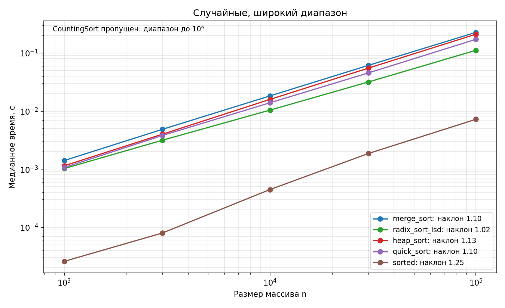
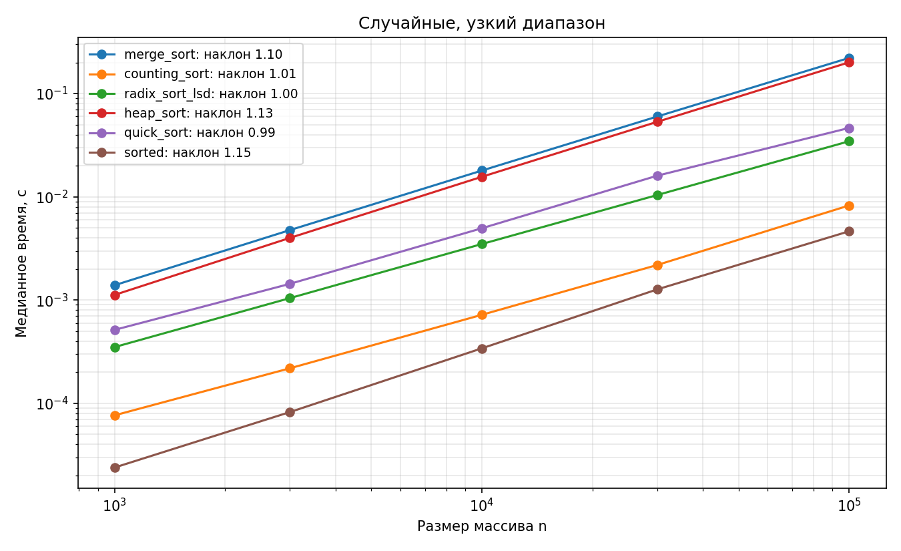
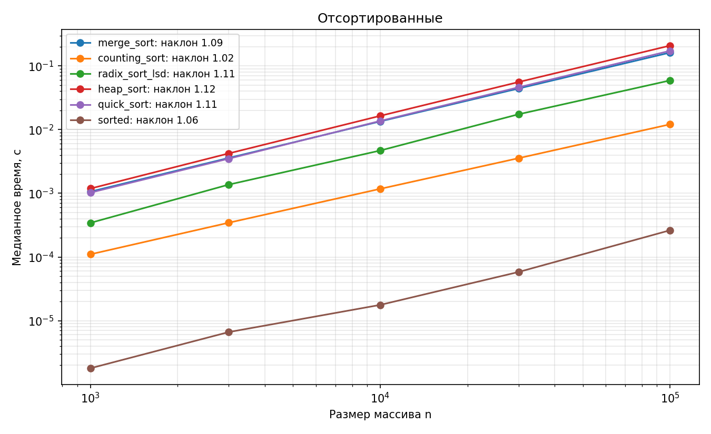
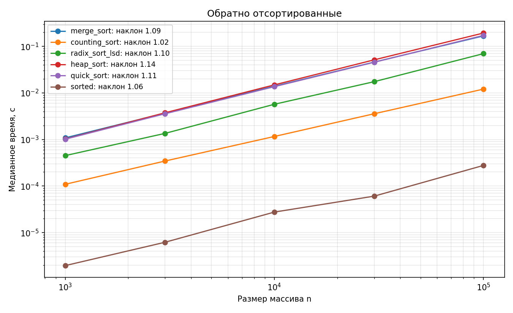
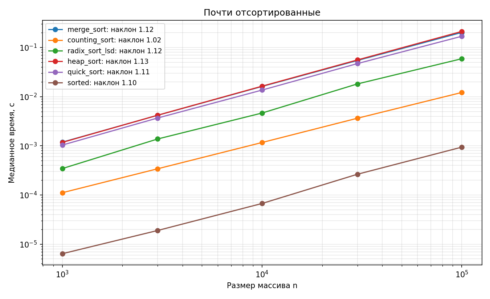

# Лабораторная работа № 4
# «MergeSort, CountingSort, RadixSort и HeapSort: оценка производительности»

- **Дисциплина:** Структуры и алгоритмы обработки данных
- **Студент:** Дикарев Кирилл
- **Группа / Профиль:** БВТ2503, ТОП-ИИ («Инженерия систем искусственного интеллекта»)
- **Вариант:** 9 (seed = 39)
- **Личный репозиторий:** [mtuci-labs-dsa](https://github.com/Kidukwe/mtuci-labs-dsa)

## 1. Цель и требования

Реализовать стабильные MergeSort и CountingSort, RadixSort LSD по десятичным разрядам и HeapSort in-place; сопоставить их с QuickSort из собственной ЛР № 3 и встроенным `sorted()`. Проверить корректность, исследовать влияние диапазона ключей и распределения входа, обосновать время, память и стабильность.

Основание — [КИМ-04](https://github.com/mel0d1an/data-structures-and-algorithms/blob/main/M2-sorting/kim-04-mergesort-linear-heapsort.md), [рубрика](https://github.com/mel0d1an/data-structures-and-algorithms/blob/main/M2-sorting/rubric-04-mergesort-linear-heapsort.md) и [методика воспроизводимости](https://github.com/mel0d1an/data-structures-and-algorithms/blob/main/docs/reproducibility.md). Исходная заготовка: ФГБОУ ВО МТУСИ, кафедра «Программная инженерия», 2026, [CC BY 4.0](https://github.com/mel0d1an/data-structures-and-algorithms/blob/main/LICENSE.md). Алгоритмы разобраны и реализованы при помощи ИИ; оформление, графики и дополнительные проверки также подготовлены с помощью ИИ. Автоматическая проверка не заменяет объяснение решения на защите.

## 2. Состав и запуск

| Файл | Назначение |
| --- | --- |
| [lab04-mergesort-linear-heapsort-starter.py](lab04-mergesort-linear-heapsort-starter.py) | Алгоритмы, оценки сложности в docstring, самопроверка, замеры и графики |
| [test_lab04.py](test_lab04.py) | 49 дополнительных тестовых случаев |
| [reports/results.json](reports/results.json) | Все пять времён каждой точки, медианы, наклоны, хеши входов и кода, условия запуска |
| [reports/run.log](reports/run.log) | Вывод итогового запуска |
| `reports/lab04_*.png` | Пять log-log графиков по распределениям |

Из корня репозитория, Python 3.10+:

```bash
source .venv/bin/activate
python -m pip install -r requirements.txt
python lab04/lab04-mergesort-linear-heapsort-starter.py --variant 9
```

Полный запуск сначала проверяет алгоритмы, затем выполняет замеры и сохраняет данные и графики в `lab04/reports`. Входы генерируются внутри сценария, как в заготовке; отдельный запуск `generate_data.py` для этой работы не требуется. Перед замерами следует подключить питание.

Проверки без замеров:

```bash
python lab04/lab04-mergesort-linear-heapsort-starter.py --variant 9 --check-only
python -m pytest -q lab04/test_lab04.py
python -O -m pytest -q lab04/test_lab04.py
```

Отдельный каталог для повторного эксперимента:

```bash
python lab04/lab04-mergesort-linear-heapsort-starter.py --variant 9 --out /tmp/lab04-run
```

Black и Ruff устанавливаются отдельно через `python -m pip install black ruff`. Проверка оформления:

```bash
python -m black --check --line-length 79 lab04/*.py
python -m ruff check --select E,F,I --line-length 79 lab04
```

## 3. Алгоритмы и обоснование сложности

### 3.1. Слияние и MergeSort

`merge` читает два уже отсортированных списка по индексам i и j. На каждом шаге выбирается меньший текущий ключ; при равенстве выбирается левый. После окончания одного списка остаток второго дописывается без сравнений.

Каждый элемент добавляется один раз: время `Θ(m + n)`, память результата `Θ(m + n)`. Три последовательных цикла не создают произведение длин. Без возвращаемого результата рабочая память — `Θ(1)`.

`merge_sort` делит список пополам, рекурсивно сортирует половины и сливает результаты. База — длина 0 или 1; возвращается копия, чтобы контракт нового списка выполнялся всегда. Один и тот же `key` передаётся по всем вызовам.

На одном уровне рекурсии обрабатывается суммарно `Θ(n)` элементов; уровней `Θ(log n)`. Поэтому `T(n) = 2T(n/2) + Θ(n) = Θ(n log n)` во всех случаях. Предварительно отсортированный вход не отменяет деление и слияния.

Пиковая дополнительная память списков — `Θ(n)`, стек — `O(log n)`. Размеры одновременно удерживаемых списков по одной ветви уменьшаются геометрически. Суммарный объём выделений за всё время может быть `Θ(n log n)`, но это не пиковая память.

Стабильность следует из выбора левого элемента при равных ключах: элементы левой половины находились в исходном списке раньше элементов правой. Условие `<=` сохраняет этот порядок при каждом слиянии.

### 3.2. CountingSort

Счётчики сначала хранят частоты, затем префиксные суммы. После накопления `counts[v]` равно числу элементов, не превышающих v. Поэтому следующая свободная позиция для v — `counts[v] - 1`. После записи счётчик уменьшается.

Обход входа с конца сохраняет порядок равных элементов: поздний элемент занимает более правую позицию. Для частот `[1, 3]` префиксы `[1, 4]`: три единицы последовательно занимают индексы 3, 2 и 1.

В нашей реализации `k = key_max + 1`, поскольку допустимые целые ключи лежат в `[0, key_max]`. Создание счётчиков и накопление занимают `Θ(k)`, проходы по входу и создание результата — `Θ(n)`. Итого время и память `Θ(n + k)`.

В формулировке задания диапазон рассматривается через `max - min`; число возможных значений при хранении со смещением было бы `max - min + 1`. Наша функция по контракту заготовки не вычитает минимум и выделяет ячейки начиная с нуля. Поэтому при узком диапазоне далеко от нуля она тоже может быть невыгодна; смещение — возможная отдельная оптимизация.

Для `random_wide` счётчики могли бы потребовать около миллиарда ячеек. Только ссылки в таком Python-списке на 64-битной платформе заняли бы около 8 ГБ, без учёта остальных расходов; линейный по диапазону проход также крайне дорог. Поэтому CountingSort на этом распределении намеренно пропущен, как в шаблоне. Это граница применимости, а не ошибка реализации.

### 3.3. RadixSort LSD

Сортировка идёт от младших десятичных разрядов к старшим: `exp = 1, 10, 100, ...`. Цифра вычисляется как `(value // exp) % 10`. Каждый проход использует десять счётчиков, префиксные суммы и стабильную расстановку с конца. В выход записывается целое число, а не извлечённая цифра.

После обработки разряда числа упорядочены по всем уже обработанным младшим разрядам. Стабильность следующего прохода сохраняет их порядок внутри равных цифр нового разряда. Например, `[21, 13, 12]` после единиц становится `[21, 12, 13]`, после десятков — `[12, 13, 21]`.

Для n элементов и d десятичных цифр максимума время `Θ(d(n + 10))`, память `Θ(n + 10) = Θ(n)`. Для максимума 0 считаем d = 1; сам код пропускает разрядный цикл и возвращает копию за `Θ(n)`. При фиксированном числе разрядов рост линейный, но если максимальное значение растёт вместе с n, d тоже может увеличиваться. Отрицательные числа явно отклоняются.

### 3.4. HeapSort и sift_down

Максимальная куча хранится в списке: для узла i дети находятся на позициях `2i + 1` и `2i + 2`. Родитель не меньше каждого ребёнка, поэтому корень — максимум.

`sift_down` выбирает большего ребёнка и меняет его с родителем, если свойство кучи нарушено. Затем продолжает вниз по этой ветви. Поддеревья детей до вызова должны быть кучами. Аргумент n задаёт активную границу: отсортированный суффикс за ней не меняется. Лучшее время просейки — `Θ(1)`, худшее `O(log n)`, память `Θ(1)`.

Куча строится снизу вверх. У большинства узлов небольшая высота: сумма работ ограничена рядом `n·Σ(h/2^h) = O(n)`, а перебор родителей даёт нижнюю границу `Ω(n)`. Поэтому построение — `Θ(n)`, а не `Θ(n log n)`.

Далее корень меняется с последним элементом активной кучи, её граница уменьшается, новый корень просеивается. Извлечённые максимумы образуют отсортированный суффикс. Общая верхняя граница — `O(n log n)`, среднее и худшее время — `Θ(n log n)`. На всех равных значениях просейки быстро прекращаются, и именно эта реализация имеет лучшее время `Θ(n)`.

HeapSort изменяет исходный список и возвращает `None`. Дополнительная память `Θ(1)`, поскольку нет копии и рекурсивного стека. Дальние обмены нарушают стабильность.

### 3.5. QuickSort из ЛР № 3

Перенесена трёхсторонняя версия: случайный опорный через `random.randrange`, области меньших, равных и больших ключей, явный стек участков `[lo, hi)`. Большая часть откладывается, меньшая обрабатывается сразу; размер стека ограничен `O(log n)`.

Для различных ключей лучшее и ожидаемое время `Θ(n log n)`, худшее `Θ(n²)`. Ожидание относится к случайному выбору опорных, а не к названию распределения входа. Рандомизация снижает вероятность последовательности плохих разбиений, но не исключает её. Все равные ключи обрабатываются одним разбиением за `Θ(n)`. Память с копией входа — `Θ(n)`. Сортировка нестабильна.

### 3.6. sorted() как эталон

`sorted()` создаёт новый список и гарантирует стабильность — [документация Python](https://docs.python.org/3.10/howto/sorting.html). В используемом CPython 3.10 это адаптивная сортировка Timsort, которая использует уже упорядоченные серии; описание реализации и временного буфера приведено в [listsort.txt](https://github.com/python/cpython/blob/3.10/Objects/listsort.txt). Поэтому она особенно быстра на прямом и обратном порядке. Для нашего эталона лучшее время `Θ(n)`, среднее и худшее `Θ(n log n)`, дополнительная память с результатом `Θ(n)`.

## 4. Сводная таблица свойств шести сортировок

Оценки считают сравнение ключей и арифметику разряда постоянными операциями. Для больших целых Python стоимость зависит от длины числа; таблица не является битовой оценкой. Средний случай сортировок сравнением относится к обычным случайным перестановкам; для QuickSort отдельно учитывается случайность опорных.

| Алгоритм | Лучшее время | Среднее / ожидаемое время | Худшее время | Дополнительная память, включая результат | Стабильность | Ограничения |
| --- | --- | --- | --- | --- | --- | --- |
| MergeSort | Θ(n log n) | Θ(n log n) | Θ(n log n) | Θ(n) | Да | Сравнимые ключи, нужна память для списков |
| CountingSort | Θ(n + k) | Θ(n + k) | Θ(n + k) | Θ(n + k) | Да | Целые 0…key_max, k = key_max + 1 |
| RadixSort LSD | Θ(d(n + 10)) | Θ(d(n + 10)) | Θ(d(n + 10)) | Θ(n) | Да | Неотрицательные целые, d разрядов, база 10 |
| HeapSort | Θ(n), все ключи равны | Θ(n log n) | Θ(n log n) | Θ(1), сортировка на месте | Нет | Сравнимые элементы; вход изменяется |
| QuickSort | Θ(n), все ключи равны | Θ(n log n) для различных ключей | Θ(n²) | Θ(n), включая копию; стек O(log n) | Нет | Сравнимые элементы, нет гарантии n log n |
| sorted() в CPython 3.10 | Θ(n) | Θ(n log n) | Θ(n log n) | Θ(n) | Да | Сравнимые элементы или функция key |

Для различных ключей лучший случай QuickSort — `Θ(n log n)`; строка таблицы учитывает также возможность одинаковых ключей. В CountingSort при фиксированных n и k порядок входа не меняет число проходов. У RadixSort число проходов зависит от максимального значения, а не только от количества элементов.

## 5. Верификация

Встроенные проверки сохранены по смыслу и переведены с `assert` на явный `expect`, который вызывает `SelfCheckError`. Поэтому проверки действуют и с `python -O`. Добавлена сверка QuickSort, не включённая в исходный `self_check`, и проверка контрактов нового списка / сортировки на месте.

| Проверка | Результат |
| --- | --- |
| Базовые случаи: пустой вход, один элемент, повторы | OK |
| Исходные 200 случайных наборов для четырёх сортировок | OK |
| Дополнительные 300 случайных наборов для MergeSort, RadixSort, QuickSort | OK |
| Порядок, сохранение мультимножества, неизменность входа возвращающих новый список функций | OK |
| Стабильность MergeSort на парах «ключ + исходный номер» | OK |
| 49 дополнительных случаев pytest | 49 passed |
| Те же тесты с python -O | 49 passed |
| Проверка каждой из 145 измеряемых комбинаций на соответствие sorted() | OK |
| Black, длина строки 79; Ruff E,F,I | OK |

Дополнительные тесты проверяют остатки слияния, отрицательные числа для разрешающих их сортировок, сохранение входа, `None` у HeapSort, границы активной кучи, отрицательный вход RadixSort, широкий диапазон и 10 000 одинаковых значений QuickSort. Стабильность MergeSort, CountingSort и RadixSort проверяется на 100 наборах для каждой функции: используются экземпляры подкласса `int` с меткой исходной позиции, чтобы равные числовые ключи можно было различить. Сам числовой ключ остаётся обычным целым по поведению.

Проверка замеров дополнительно подтверждает свежую копию на каждый повтор и исключение прогрева из пяти измерений. В режиме `-O` pytest выводит собственное предупреждение об отключении обычных assert; наши явные проверки продолжают работать.

Технический вывод о применимости по [методике верификации](https://github.com/mel0d1an/data-structures-and-algorithms/blob/main/docs/ai-verification.md): **принять для заданных контрактов**. Тесты и аналитическое обоснование согласованы; понимание на защите оценивается отдельно.

## 6. Методика и условия замеров

- **Вариант:** 9, seed 39.
- **Машина:** Apple M5, arm64; macOS-26.6.2-arm64-arm-64bit; Python 3.10.7, Matplotlib 3.10.9.
- **Завершение прогона:** 05.11.2026 22:29:47, московское время.
- **Питание:** от сети до и после прогона и во всех 145 проверках после измеряемых точек.
- **Размеры:** 1 000, 3 000, 10 000, 30 000, 100 000.
- **Входы:** случайные 0…10⁹; случайные 0…100; прямой порядок; обратный порядок; прямой порядок после примерно 1 % случайных обменов.
- Данные всех размеров заранее генерируются отдельным `random.Random(39)` в том же порядке, что в заготовке. Все алгоритмы получают одинаковые значения для одной комбинации размера и распределения. Хеш входа хранится в каждой строке JSON.
- Глобальный генератор QuickSort инициализируется один раз в начале программы. Самопроверка и сортировки используют воспроизводимую последовательность опорных; в разных повторах она не сбрасывается, поэтому опорные могут различаться.
- `time.perf_counter()`, один прогрев, пять повторов, медиана. Всего 145 измеряемых точек, 725 времён; ещё 5 комбинаций CountingSort пропущены по диапазону.
- Для каждого запуска создаётся свежая копия входа до таймера. Внутренние копии MergeSort, RadixSort и QuickSort входят в измеряемое время; освобождение возвращённого результата выполняется после замера. HeapSort получает такую же внешнюю копию, но сам дополнительного массива не создаёт.
- Время CountingSort в бенчмарке включает вычисление `max(a)` для параметра `key_max`. Это дополнительный линейный проход, не меняющий оценку `Θ(n + k)`.
- Проверка результата каждой комбинации проводится отдельно вне таймера. Циклический GC не отключается; фоновые процессы специально не контролировались.

Результаты ниже получены новым запуском после оформления кода; это не копия округлённых чисел из ранее присланного терминального вывода. Повторение может дать другие времена.

## 7. Результаты: медианное время в секундах

### Случайные, широкий диапазон

| Алгоритм | 1000 | 3000 | 10000 | 30000 | 100000 |
| --- | --- | --- | --- | --- | --- |
| merge_sort | 0.001408 | 0.004856 | 0.018303 | 0.061283 | 0.226864 |
| counting_sort | — | — | — | — | — |
| radix_sort_lsd | 0.001025 | 0.003151 | 0.010412 | 0.031705 | 0.111433 |
| heap_sort | 0.001142 | 0.004006 | 0.015924 | 0.054920 | 0.210929 |
| quick_sort | 0.001068 | 0.003809 | 0.013937 | 0.045399 | 0.172396 |
| sorted | 0.000026 | 0.000080 | 0.000447 | 0.001860 | 0.007229 |



### Случайные, узкий диапазон

| Алгоритм | 1000 | 3000 | 10000 | 30000 | 100000 |
| --- | --- | --- | --- | --- | --- |
| merge_sort | 0.001394 | 0.004761 | 0.017969 | 0.059943 | 0.221588 |
| counting_sort | 0.000077 | 0.000219 | 0.000721 | 0.002187 | 0.008257 |
| radix_sort_lsd | 0.000351 | 0.001045 | 0.003493 | 0.010406 | 0.034559 |
| heap_sort | 0.001123 | 0.004001 | 0.015643 | 0.053244 | 0.200839 |
| quick_sort | 0.000515 | 0.001436 | 0.004964 | 0.016013 | 0.046508 |
| sorted | 0.000024 | 0.000082 | 0.000341 | 0.001269 | 0.004643 |



### Отсортированные

| Алгоритм | 1000 | 3000 | 10000 | 30000 | 100000 |
| --- | --- | --- | --- | --- | --- |
| merge_sort | 0.001062 | 0.003588 | 0.013452 | 0.044189 | 0.161908 |
| counting_sort | 0.000110 | 0.000345 | 0.001175 | 0.003560 | 0.012108 |
| radix_sort_lsd | 0.000343 | 0.001368 | 0.004694 | 0.017408 | 0.059156 |
| heap_sort | 0.001187 | 0.004227 | 0.016449 | 0.055792 | 0.208380 |
| quick_sort | 0.001025 | 0.003496 | 0.013688 | 0.046158 | 0.172524 |
| sorted | 0.000002 | 0.000007 | 0.000018 | 0.000058 | 0.000263 |



### Обратный порядок

| Алгоритм | 1000 | 3000 | 10000 | 30000 | 100000 |
| --- | --- | --- | --- | --- | --- |
| merge_sort | 0.001083 | 0.003690 | 0.013930 | 0.045921 | 0.167789 |
| counting_sort | 0.000109 | 0.000345 | 0.001161 | 0.003571 | 0.012090 |
| radix_sort_lsd | 0.000451 | 0.001352 | 0.005709 | 0.017439 | 0.069804 |
| heap_sort | 0.001025 | 0.003745 | 0.014889 | 0.051330 | 0.193449 |
| quick_sort | 0.001015 | 0.003570 | 0.013633 | 0.045553 | 0.172018 |
| sorted | 0.000002 | 0.000006 | 0.000028 | 0.000061 | 0.000277 |



### Почти отсортированные

| Алгоритм | 1000 | 3000 | 10000 | 30000 | 100000 |
| --- | --- | --- | --- | --- | --- |
| merge_sort | 0.001187 | 0.004177 | 0.016140 | 0.054487 | 0.202581 |
| counting_sort | 0.000111 | 0.000341 | 0.001168 | 0.003639 | 0.012176 |
| radix_sort_lsd | 0.000344 | 0.001377 | 0.004646 | 0.018157 | 0.059173 |
| heap_sort | 0.001173 | 0.004191 | 0.016341 | 0.055831 | 0.212603 |
| quick_sort | 0.001035 | 0.003678 | 0.013621 | 0.047082 | 0.169493 |
| sorted | 0.000006 | 0.000019 | 0.000067 | 0.000264 | 0.000940 |



## 8. Наклоны и интерпретация

| Алгоритм | random_wide | random_small | sorted | reversed | almost_sorted |
| --- | --- | --- | --- | --- | --- |
| merge_sort | 1.103 | 1.100 | 1.091 | 1.095 | 1.116 |
| counting_sort | — | 1.013 | 1.019 | 1.021 | 1.022 |
| radix_sort_lsd | 1.015 | 0.997 | 1.115 | 1.098 | 1.117 |
| heap_sort | 1.134 | 1.126 | 1.122 | 1.138 | 1.128 |
| quick_sort | 1.098 | 0.992 | 1.115 | 1.113 | 1.107 |
| sorted | 1.252 | 1.153 | 1.055 | 1.059 | 1.096 |

Для `t(n) ≈ c n^p` наклон на log-log графике равен p. `n log n` не является чистой степенью: на конечном диапазоне его наклон обычно немного больше 1. Поэтому числа из таблицы — эмпирические оценки, а не новые точные показатели сложности.

- **Широкий случайный диапазон:** CountingSort пропущен; RadixSort использует не более десяти разрядов и показывает близкий к линейному рост. MergeSort, HeapSort и QuickSort согласуются с характером `n log n`.
- **Узкий диапазон:** CountingSort имеет фиксированный k = 101, RadixSort — не более трёх разрядов. Их рост близок к линейному. Трёхсторонний QuickSort эффективно убирает многочисленные равные ключи; его наклон тоже близок к 1 на этом распределении.
- **Прямой и обратный порядок:** MergeSort сохраняет деление и слияния, HeapSort — работу с кучей, а случайный опорный QuickSort предотвращает систематический выбор края только из-за порядка входа. CountingSort имеет k порядка n, поэтому остаётся линейным. У RadixSort число разрядов увеличивается вместе с n; наклон может быть выше 1.
- **Почти отсортированные данные:** около 1 % случайных обменов не меняет гарантии наших сортировок. `sorted()` способен использовать уже упорядоченные серии, но это не означает гарантированное линейное время для любого почти отсортированного массива.
- `sorted()` быстрее собственных функций по постоянным расходам: основная работа выполняется в C; на структурированных данных помогает адаптивность. Его локальный наклон на случайных данных может заметно отличаться от идеализированного n log n из-за конечного диапазона и системных эффектов. Их отдельный вклад не измерялся.

Сравнивать асимптотику нужно при учёте n, k и d. Быстрый результат на пяти точках не доказывает общую оценку и не гарантирует те же времена на другой машине.

## 9. Выводы и подготовка к защите

1. MergeSort стабилен благодаря выбору левого элемента при равных ключах; время `Θ(n log n)`, пиковая память `Θ(n)`.
2. CountingSort выгоден при небольшом диапазоне: его затраты определяются `n + k`, а не только числом элементов.
3. RadixSort обрабатывает цифры, сохраняя достигнутый порядок младших разрядов стабильными проходами; время зависит от числа разрядов.
4. HeapSort строит кучу за `Θ(n)`, затем сортирует с верхней границей `O(n log n)` и постоянной вспомогательной памятью. Он изменяет вход и нестабилен.
5. QuickSort из ЛР № 3 и встроенный `sorted()` включены в сравнение на одинаковых входах; различия по константам и распределениям объяснены.
6. Самопроверка и 49 дополнительных тестов проходят, включая `python -O`. Полный эксперимент сохранён вместе с пятью графиками и таблицей свойств.

**Нижняя граница сортировок сравнением:** для различных элементов возможны n! порядков. Дерево сравнений должно различить их; его высота не меньше `log₂(n!) = Ω(n log n)`. CountingSort и RadixSort не ограничиваются попарными сравнениями: они используют числовые значения как индексы и извлекают цифры. Поэтому их оценки не противоречат этой границе, но зависят от диапазона и разрядности ключей.

Для повторения: проследить слияние `[1, 4]` и `[2, 3]`; частоты и префиксы для `[2, 0, 2, 1]`; проходы единиц и десятков для `[21, 13, 12]`; построение max-кучи и уменьшение её активной границы; отличие возвращаемого списка от изменения входа на месте.
