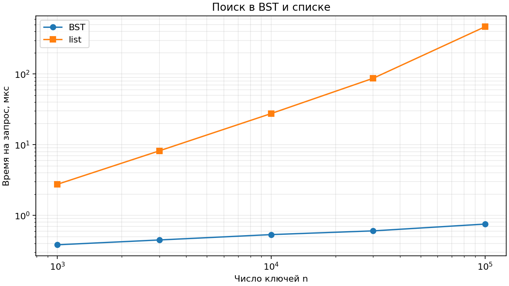
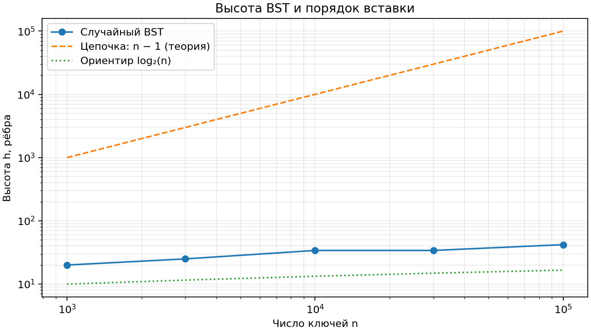

# Лабораторная работа № 5

**Бинарное дерево поиска, обходы, вставка, поиск и удаление**

Вариант 9, seed 39. Реализация следует [КИМ-05](https://github.com/mel0d1an/data-structures-and-algorithms/blob/main/M3-trees/kim-05-bst.md) и интерфейсу заготовки курса МТУСИ, лицензия [CC BY 4.0](https://github.com/mel0d1an/data-structures-and-algorithms/blob/main/LICENSE.md). Код и материалы подготовлены с помощью ИИ. Ниже приведены результаты верификации.

- [Реализация BST](bst.py) — отдельный модуль для повторного использования, в том числе в ДЗ № 2.
- [Самопроверка и замеры](lab05-bst-starter.py) · [Дополнительные тесты](test_lab05.py) · [Исходные результаты](reports/results.json) · [Журнал запуска](reports/run.log).

## Запуск

Из корня репозитория при установленных зависимостях из `requirements.txt`:

```bash
source .venv/bin/activate
python lab05/lab05-bst-starter.py --variant 9 --check-only
python -m pytest -q lab05
python lab05/lab05-bst-starter.py --variant 9 --out /tmp/lab05-run
```

Последняя команда создаёт два графика и JSON. Если опустить `--out`, файлы записываются в `lab05/reports`.

## Как устроено дерево

**Узел** хранит целый **ключ** и ссылки `left` и `right` на детей. **Корень** — верхний узел. **Лист** — узел без детей. **Поддерево** состоит из узла и всех его потомков. **Глубина** узла — число рёбер от корня до него. **Высота** дерева — наибольшая глубина. Для пустого дерева принята высота −1, для одного узла — 0. **Ширина** — наибольшее число узлов на одном уровне.

**Инвариант BST** действует для целых поддеревьев: все ключи слева от любого узла строго меньше его ключа, все справа строго больше. Поэтому сравнение с текущим узлом позволяет выбрать только одну ветвь. Дубликаты игнорируются, как при добавлении в множество.

| Что открыть | Что происходит |
| --- | --- |
| [`Node`, `BST.__init__`](bst.py#L11) | Узел хранит ключ и две ссылки. Дерево начинает с пустого корня и нулевого размера. |
| [`insert`](bst.py#L29) | Идёт по сравнениям до свободной ссылки, присоединяет лист и увеличивает счётчик. |
| [`search`](bst.py#L48) | Идёт по одной ветви до совпадения или пустой ссылки. Возвращает `True` или `False`. |
| [`delete`](bst.py#L57) | Находит узел и его родителя. Отвязывает лист, поднимает единственного ребёнка или переносит ключ преемника и удаляет его прежний узел. |
| [`in_order`, `pre_order`, `post_order`](bst.py#L85) | Меняют момент записи ключа относительно посещения детей. Общий рекурсивный обход `_depth_first` повторяет работу с явным стеком через `_depth_first_iterative`, если достигнут лимит рекурсии Python. |
| [`level_order`](bst.py#L140) | Обходит уровни через очередь FIFO на `deque`. Берёт узел через `popleft`, ставит детей в конец очереди. |
| [`height`](bst.py#L156) | Хранит в стеке пары «узел, глубина» и находит максимальную глубину. |
| [`size`](bst.py#L172) | Возвращает счётчик за константное время. Счётчик меняется только при успешной вставке или удалении. |

### Как объяснить удаление с двумя детьми

Пусть вставка ключей `50, 30, 80, 60, 90, 55, 57` создала дерево:

```text
        50
       /  \
     30    80
          /  \
         60   90
        /
       55
         \
          57
```

При удалении 50 ищем его **преемника** — ближайший больший ключ. Это минимум правого поддерева. Идём от 80 влево до 55. Все ключи в левом поддереве меньше 55, а все оставшиеся в правом больше 55. Копируем 55 в корень. У прежнего узла 55 левого ребёнка быть не может, иначе он бы не был минимумом. Его правый ребёнок 57 занимает его прежнее место, то есть становится левым ребёнком 60. Удалён один узел, поэтому размер уменьшается ровно на один.

Пример для демонстрации из корня репозитория:

```python
from lab05.bst import BST

tree = BST()
for key in (50, 30, 80, 60, 90, 55, 57):
    tree.insert(key)

print(tree.level_order(), tree.height(), tree.size())
tree.delete(50)
print(tree.in_order(), tree.level_order(), tree.height(), tree.size())
```

До удаления обход по уровням даёт `[50, 30, 80, 60, 90, 55, 57]`, высота 4, размер 7. После удаления in-order даёт `[30, 55, 57, 60, 80, 90]`, по уровням получается `[55, 30, 80, 60, 90, 57]`, высота 3, размер 6.

### Как запомнить обходы

Для одного дерева с корнем 4 и порядком вставки `4, 2, 6, 1, 3, 5, 7`:

| Обход | Порядок | Результат | Зачем нужен |
| --- | --- | --- | --- |
| In-order, симметричный | Лево → узел → право | 1, 2, 3, 4, 5, 6, 7 | Получить ключи по возрастанию и проверить инвариант. |
| Pre-order, прямой | Узел → лево → право | 4, 2, 1, 3, 6, 5, 7 | Обработать родителя первым, например при записи структуры с маркерами пустых детей. |
| Post-order, обратный | Лево → право → узел | 1, 3, 2, 5, 7, 6, 4 | Сначала собрать результаты детей, например вычислить размеры поддеревьев. |
| Level-order, в ширину | По уровням, слева направо | 4, 2, 6, 1, 3, 5, 7 | Посмотреть структуру по глубине. |

### Сложность и балансировка

Для непустого дерева с высотой `h` один спуск посещает не более `h + 1` узлов. При удалении с двумя детьми поиск узла и дальнейший поиск преемника вместе образуют путь вниз. Все три операции используют постоянное число ссылок.

| Операция | Время | Рабочая память |
| --- | --- | --- |
| `insert`, `search`, `delete` | O(h + 1), O(1) для пустого дерева | Θ(1) |
| In-order, pre-order, post-order | Θ(n) | O(h + 1) без списка ответа |
| Level-order | Θ(n) | O(w) без списка ответа, где w — ширина |
| `height` | Θ(n) | O(h + 1) |
| `size` | Θ(1) | Θ(1) |
| Само дерево | — | Θ(n), по узлу на ключ |

При случайной перестановке различных ключей **ожидаемая высота** BST имеет порядок Θ(log n). Отдельное дерево может быть несимметричным. При вставке уникальных ключей по возрастанию каждый становится правым ребёнком предыдущего. При убывании получается левая цепочка. В обоих случаях `h = n − 1`, а поиск глубокого ключа, вставка в конец или удаление глубокого узла достигают Θ(n). Последовательное построение такой цепочки обычной вставкой стоит Θ(n²). [Исследование высоты случайного BST, Л. Деврой](https://luc.devroye.org/Devroye-1987-BranchingProcessesintheAnalysisoftheHeightsofTrees-ActaInformatica.pdf)

**AVL** — самобалансирующееся BST. У каждого узла высоты поддеревьев отличаются максимум на один. После вставки или удаления баланс восстанавливают **поворотами**. Гарантия для высоты — примерно `1,44·log₂(n)` с поправкой. С нашей высотой в рёбрах аккуратная верхняя оценка имеет вид `h ≤ logφ(n + 1) − 1`, где `φ ≈ 1,618`. Она следует из минимального числа узлов `N(h) = 1 + N(h−1) + N(h−2) = F(h+3) − 1` при `N(−1)=0`, `N(0)=1` и `F(0)=0`, `F(1)=1`. Отсюда операции AVL гарантированно укладываются в O(log n). [Материалы SDSU об AVL](https://eli.sdsu.edu/courses/fall95/cs660/notes/AVL/AVL.html)

## Проверка реализации

`self_check` проверяет пустое дерево, дубликаты, все три случая удаления, четыре обхода на известном дереве, высоту и размер. На 100 последовательностях из **3 837 случайных команд** поиск сверяется с `in` у множества, in-order после каждой команды совпадает с `sorted(set)`, размер — с размером множества. Явный `expect` поднимает исключение при ошибке, поэтому встроенная самопроверка работает и с `python -O`.

Дополнительные тесты покрывают удаление корня и некорневых узлов, переподключение правого ребёнка преемника, отрицательные ключи и ноль, все три обхода на цепочке глубже лимита рекурсии, смешанные операции и запуск самопроверки в двух режимах. Значения сравниваются с эталонами вне измерений.

## Эксперимент

Apple M5, macOS, Python 3.10.7. Система указывала питание от сети перед прогоном, после каждой точки и в конце. Генератор `random.Random(39)` последовательно создаёт для каждого размера случайные уникальные ключи и одну пачку из 1 000 запросов. Список и заранее построенное дерево содержат одинаковые ключи. Оба поиска получают одинаковые запросы в одинаковом порядке. Для списка измеряется обычный оператор `in`.

Каждая точка — медиана пяти засечек одной пачки после прогрева, делённая на 1 000 и переведённая в микросекунды. Построение дерева, генерация данных и проверка ответов в измеряемое время не входят. «Попадания» — запросы, ключи которых присутствуют в обеих структурах.

| Ключей n | Высота h | Попадания из 1 000 | BST, мкс/запрос | Список, мкс/запрос |
| ---: | ---: | ---: | ---: | ---: |
| 1 000 | 20 | 104 | 0,384 | 2,752 |
| 3 000 | 25 | 106 | 0,449 | 8,196 |
| 10 000 | 34 | 108 | 0,535 | 27,607 |
| 30 000 | 34 | 81 | 0,604 | 87,167 |
| 100 000 | 42 | 95 | 0,753 | 466,428 |



Обе оси логарифмические. При переходе от 1 000 к 100 000 ключей медианное время на запрос у BST выросло примерно в **2,0 раза**, у списка — в **170 раз**. В нашей пачке около 90% запросов промахиваются, а для промаха список проверяет все элементы. Поэтому его рост близок к линейному по характеру, хотя время на элемент и выигрыш зависят от размера, памяти и машины. BST на каждом сравнении выбирает одну ветвь, поэтому время растёт намного медленнее. Высота даёт максимальный путь, а измеренное время усреднено по разным запросам в пачке.



Сплошная линия показывает измеренную высоту **одного случайного дерева на размер**. Точечная `log₂(n)` — ориентир масштаба идеальной сбалансированности. Штриховая `n − 1` — точная теоретическая высота цепочки при вставке отсортированных ключей. Для 100 000 узлов получено **42 ребра** у случайного BST, у цепочки было бы **99 999**. При 10 000 и 30 000 узлах у двух конкретных деревьев получилась одинаковая высота 34. Эксперимент иллюстрирует зависимость от формы дерева, а оценка ожидаемой высоты следует из анализа случайного порядка вставки.

В этих условиях BST существенно ускоряет поиск по уже построенной структуре. Для упорядоченного потока и гарантированного времени в худшем случае нужна балансировка, например AVL.
